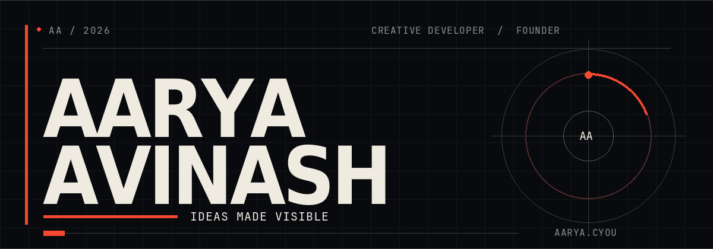

  

  <strong>I build websites that feel like places.</strong> 
  Student developer &nbsp;·&nbsp; Founder of <a href="https://github.com/zyrixdevs">Zyrix Dev</a> &nbsp;·&nbsp; Creator of interactive worlds

  <a href="https://aarya.cyou/">PORTFOLIO ↗</a> &nbsp;&nbsp; / &nbsp;&nbsp;
  <a href="https://github.com/aaryaavinash?tab=repositories">PROJECTS ↗</a> &nbsp;&nbsp; / &nbsp;&nbsp;
  <a href="mailto:hello@aarya.cyou">SAY HELLO ↗</a>

  

 

### 01 / A little about me

I'm Aarya. I work where frontend development meets visual storytelling: expressive typography, considered motion, and small details that make a page feel alive. My [portfolio](https://aarya.cyou/) brings together software, design, games, and the ideas I'm exploring as a student and founder.

The worlds below are independent projects, each with its own source, credits, and notes. Open one and take your time.

 

### 02 / Selected worlds

<table>
  <tr>
    <td width="50%" valign="top">
       
      <strong>01 — <a href="https://github.com/aaryaavinash/florae">Florae</a></strong> 
      A botanical atelier imagining one remarkable flower each month. 
      <a href="https://florae.aarya.cyou/">Visit the world ↗</a>
    </td>
    <td width="50%" valign="top">
       
      <strong>02 — <a href="https://github.com/aaryaavinash/atlas">Atlas of Drifting Isles</a></strong> 
      Four islands and an airship passage above a cloud sea. 
      <a href="https://atlas.aarya.cyou/">Explore the map ↗</a>
    </td>
  </tr>
  <tr>
    <td width="50%" valign="top">
       
      <strong>03 — <a href="https://github.com/aaryaavinash/nocturne">Nocturne No. 9</a></strong> 
      A fragrance story told note by note, before the bottle appears. 
      <a href="https://nocturne.aarya.cyou/">Discover Nocturne ↗</a>
    </td>
    <td width="50%" valign="top">
       
      <strong>04 — <a href="https://github.com/aaryaavinash/racer">Nightshift Motor Co.</a></strong> 
      A hand-built café racer from a garage that opens after dark. 
      <a href="https://racer.aarya.cyou/">See the bike ↗</a>
    </td>
  </tr>
</table>

<a href="https://github.com/aaryaavinash?tab=repositories"><strong>VIEW ALL PROJECTS ↗</strong></a>

 

### 03 / The toolkit

  <code>JavaScript</code> &nbsp; <code>TypeScript</code> &nbsp; <code>Vite</code> &nbsp; <code>Tailwind CSS</code> &nbsp; <code>GSAP</code> &nbsp; <code>Lenis</code> &nbsp; <code>Cloudflare Pages</code>

I enjoy building the full journey: the first sketch, the movement between sections, and the version that finally goes live.

 

### 04 / Live signal

  

   
  Discord card by <a href="https://github.com/the-snesler/discord-github-readme">Discord GitHub Preview</a>

 

---

  <a href="https://aarya.cyou/">aarya.cyou</a> &nbsp;·&nbsp;
  <a href="https://github.com/zyrixdevs">Zyrix Dev</a> &nbsp;·&nbsp;
  <a href="https://www.instagram.com/aaryaavinash_/">Instagram</a> &nbsp;·&nbsp;
  <a href="mailto:hello@aarya.cyou">Email</a>

Made with curiosity by Aarya Avinash.

